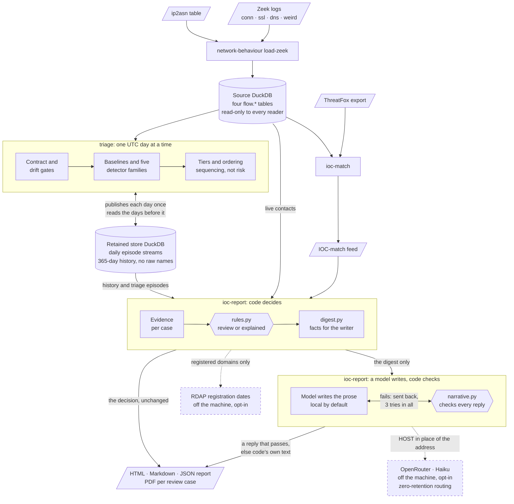

# flowcase

**Work in progress.** Daily behavioural triage and IOC case reports for a large network, being moved onto
Zeek logs.

The code grew out of a security project on a large Australian university's network. That
deployment read a commercial flow-telemetry platform. This repository replaces that source with Zeek and a
synthetic dataset, so it runs anywhere and holds no data from that network.

| Path | What it holds |
|---|---|
| `packages/triage` | `network-behaviour`: publishes one immutable stream of behavioural episodes per UTC day, then orders the hosts worth a look. Ordering is sequencing, never risk |
| `packages/ioc-report` | `ioc-report`: decides every IOC match in code (`review` or `explained`), then has a model write the case up. Code checks every reply, and its own text stands when a reply fails |
| `docs/` | Case study, architecture and source contract (coming) |
| `demo/` | A synthetic Zeek network with planted cases, and `make demo`, which runs everything and checks each case |
| `fixtures/zeek-real/` | A synthetic capture and the logs real Zeek wrote from it, for a compatibility test |

## Architecture



## Develop

Needs [uv](https://docs.astral.sh/uv/) and Python 3.12 or newer.

```shell
make sync         # uv sync --all-packages --all-extras
make check        # format, lint, types, generated docs and tests for both packages, and the leak check
make demo         # the whole pipeline on a synthetic network, checked case by case (see demo/README.md)
make demo-small   # the same cases on fewer background hosts, as CI runs it
make zeek-fixture # rebuild fixtures/zeek-real with scapy and real Zeek (needs Docker)
```

The leak check (`scripts/check_leaks.py`) fails on any IPv4 address outside the private, documentation
and benchmarking ranges, except a few named public services, and on any data file outside
`fixtures/zeek-real/`.
