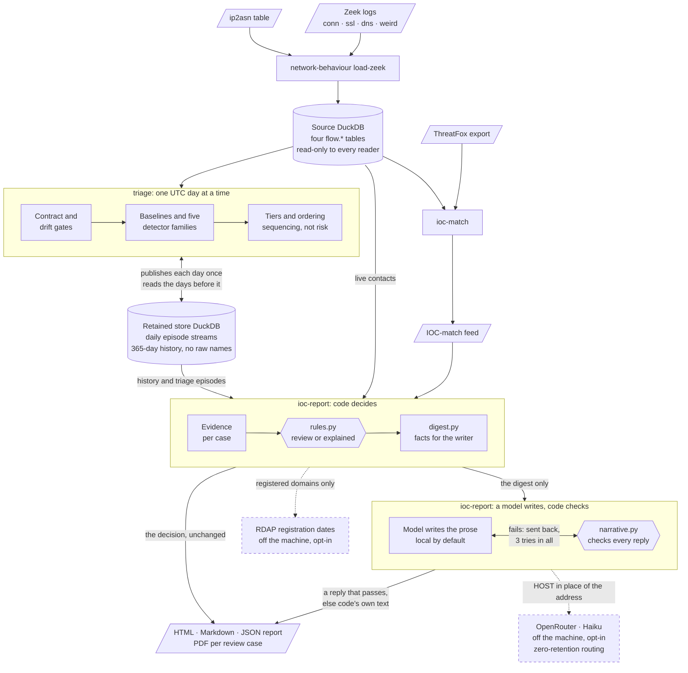

# flowcase

Daily behavioural triage and IOC case reports for a large network, on Zeek logs.

I designed and built it for a large Australian university's network, as part of the university's security
project, and ran it on the network's commercial flow probe from July to November 2026: 92 days of triage
published and 89 IOC cases decided. This repository runs it on Zeek logs and a synthetic network instead, so it
runs anywhere and holds no data from that network. [`docs/CASE_STUDY.md`](docs/CASE_STUDY.md) records what that
deployment measured, what the measurements decided and what it produced.

## The problem

That network's flow probe wrote about 30 million per-minute rows a day, from some 11,500 addresses. No one can
read that, so a security team needs two answers from it instead:

- **Which hosts are worth a look today, and in what order?**
- **When a threat list's indicator matches the network's traffic, is there an ordinary reason?** Most matches
  have one, such as a laptop reaching a shared CDN address that also hosts something bad.

Flow records carry no payload, process or user, so they cannot show that a host is compromised, and nothing
here says so.

## How it works

1. **Load.** `network-behaviour load-zeek` turns each day of Zeek logs into four tables in a DuckDB file:
   activity per minute, load per five minutes, long flows and DNS. Nothing after this step reads Zeek.
2. **Triage.** `network-behaviour run-day` compares each host with its own past and with hosts like it, and
   publishes the day's behavioural episodes once, in the order to look at them. The order is sequencing, not
   risk.
3. **Match.** `ioc-match` finds where a ThreatFox export's indicators appear in that traffic.
4. **Decide.** `ioc-report` decides every match in code: `explained` only when an ordinary reason covers every
   contact with the flagged address and no rule keeps the case open, `review` otherwise. "Explained" is about
   the match, never about the host.
5. **Write.** A model writes each case up from the facts code gathered, and code checks every reply. A failed
   reply goes back, and after three tries code's own text stands. The result is an HTML report and, on
   request, a one-page PDF for each case kept for review.

[`demo/sample-output/`](demo/sample-output/) holds one run's output on the demo's synthetic network: the HTML
report, one-page PDFs for three of its review cases, and one of those again with the paragraphs written by
Claude Haiku.

## Architecture



[`docs/ARCHITECTURE.md`](docs/ARCHITECTURE.md) says where each part lives and why: the pipeline, the source
boundary and its seams, where code decides and the model writes, and the privacy boundary.

## Repository

| Path | What it holds |
|---|---|
| `packages/triage` | `network-behaviour`: publishes one immutable stream of behavioural episodes per UTC day, then orders the hosts worth a look. Ordering is sequencing, never risk |
| `packages/ioc-report` | `ioc-report`: decides every IOC match in code (`review` or `explained`), then has a model write the case up. Code checks every reply, and its own text stands when a reply fails |
| `docs/` | The architecture, the case study and the source contract |
| `demo/` | A synthetic Zeek network with planted cases, and `make demo`, which runs everything and checks each case |
| `fixtures/zeek-real/` | A synthetic capture and the logs real Zeek wrote from it, for a compatibility test |

## Develop

Needs [uv](https://docs.astral.sh/uv/) and Python 3.12 or newer.

```shell
make sync         # uv sync --all-packages --all-extras
make check        # format, lint, types, generated docs and tests for both packages, and the leak check
make demo         # the whole pipeline on a synthetic network, checked case by case (see demo/README.md)
make demo-small   # the same cases on fewer background hosts, as CI runs it
make zeek-fixture # rebuild fixtures/zeek-real with scapy and real Zeek (needs Docker)
```

The leak check (`scripts/check_leaks.py`) fails on any IPv4 address outside the private, documentation
and benchmarking ranges, except a few named public services, and on any data file outside
`fixtures/zeek-real/`.

## Built with Claude Code

This repository was built with [Claude Code](https://claude.com/claude-code). The `CLAUDE.md` files at the
root and in each package are the rules every change was made under: synthetic data only, code decides and the
model writes, no host verdicts, and numbers from measurement.
